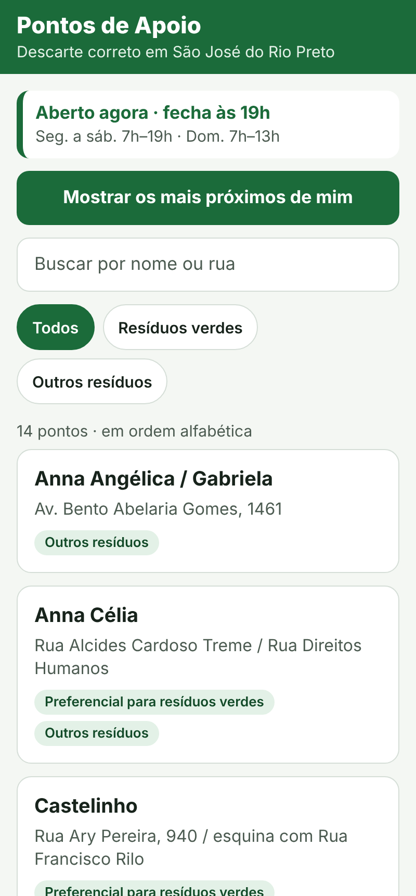
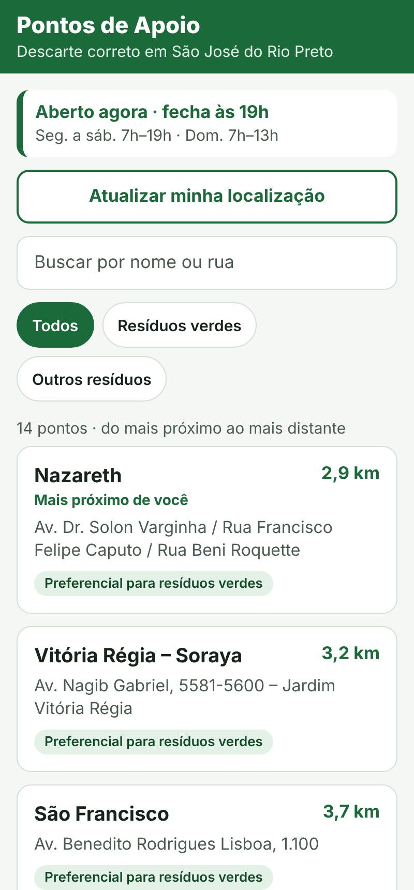
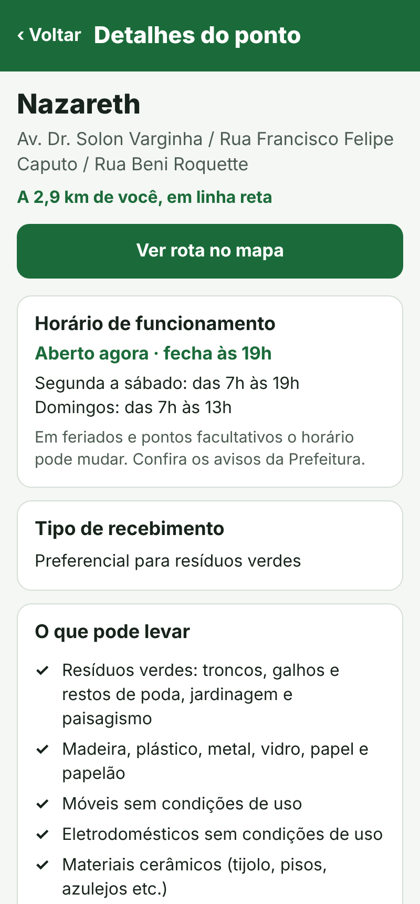

# Pontos de Apoio Rio Preto

Aplicativo Android para localizar os Pontos de Apoio municipais de descarte de materiais e resíduos em São José do Rio Preto – SP.

Projeto da disciplina **Atividade Extensionista II: Tecnologia Aplicada à Inclusão Digital – Projeto** (UNINTER, CST em Análise e Desenvolvimento de Sistemas), ligado aos ODS 11 e 12.

Aluno: Ian Rafael Ferreira Batista – RU 4388635

> Este não é um aplicativo oficial da Prefeitura.

## O que o app faz

- Lista os 14 Pontos de Apoio em funcionamento, com endereço e tipo de recebimento.
- Ordena os pontos do mais próximo ao mais distante, usando a localização do aparelho (Expo Location), somente depois que o usuário autoriza.
- Mostra se os pontos estão abertos agora e o horário de funcionamento.
- Mostra o que pode e o que não pode ser levado.
- Abre a rota até o ponto no aplicativo de mapas (Google Maps).
- Busca por nome ou rua e filtro por tipo de resíduo.
- Funciona sem internet para consultar a lista (os dados ficam no próprio app).

| Lista | Mais próximos | Detalhes |
| --- | --- | --- |
|  |  |  |

## Tecnologias

React Native, Expo (SDK 58), TypeScript e Expo Location.

## Como executar

Requisitos: Node.js 20 ou superior e o aplicativo **Expo Go** no celular Android (ou um emulador Android).


npm install
npx expo start


Leia o QR Code com o Expo Go. Para abrir direto em um emulador: `npm run android`.

Outros comandos:


npm test           # testes das regras de distância, horário, filtro e rota
npm run typecheck  # verificação de tipos


## Baixar o aplicativo (Android)

[Baixar o APK](https://expo.dev/accounts/ianraf/projects/pontos-de-apoio-rp/builds/90309538-b458-47b3-8406-0ea48d99164f)

Abra o link no celular Android, toque em Install e permita a instalação de fontes desconhecidas, se o Android pedir.

## Estrutura

```
App.tsx                  navegação entre as três telas
src/data/pontos.ts       dados dos Pontos de Apoio (fonte oficial)
src/hooks/               permissão e leitura da localização
src/screens/             Lista, Detalhes e Informações
src/components/          cartão do ponto, botão, seções
src/utils/               distância, horário, filtro, link da rota
tests/                   testes automatizados
```

## Fonte dos dados

Nomes, endereços, horários e materiais aceitos: Prefeitura de São José do Rio Preto, página [Pontos de Apoio](https://www.riopreto.sp.gov.br/pontodeapoio).

As coordenadas foram obtidas pela geocodificação dos endereços oficiais e são aproximadas.

## Privacidade

A localização é usada apenas no aparelho para calcular distâncias. Ela não é salva nem enviada para nenhum servidor.
